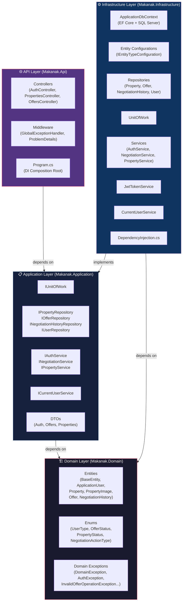
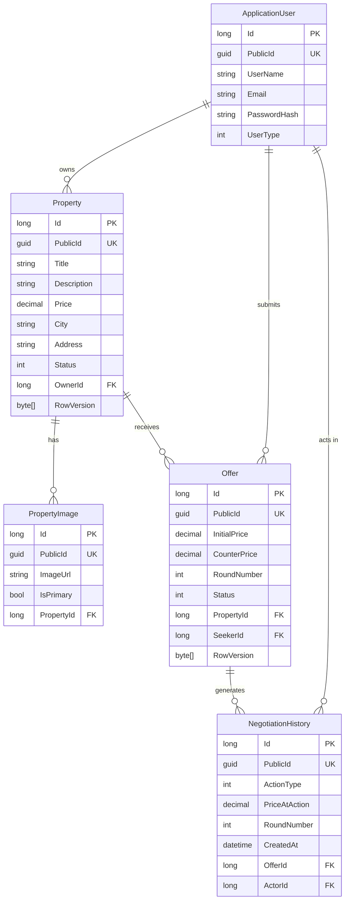
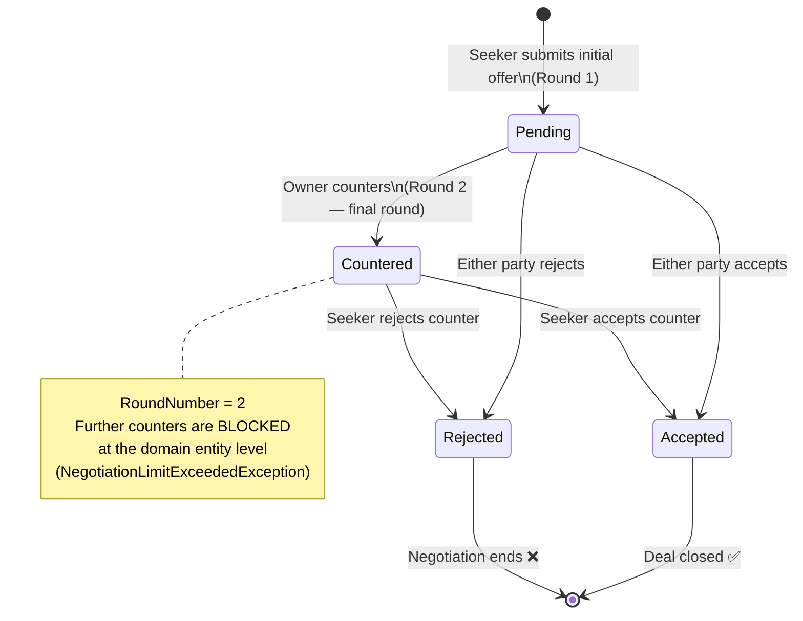

<div align="center">

# 🏠 Makanak Platform

### *Real Estate, Reimagined — No Brokers. No Fees. Just Deals.*

<br/>

[](https://dotnet.microsoft.com/)
[](https://learn.microsoft.com/en-us/ef/core/)
[](https://www.microsoft.com/en-us/sql-server)
[](https://jwt.io/)
[](LICENSE)
[](https://github.com/Mustafa3mr1/Makanak-Platform)
[](https://depi.gov.eg/)

<br/>

> **Makanak** *(Arabic: مكانك — "Your Place")* is a production-grade B2C real estate marketplace that eliminates the middleman. Property owners list directly. Seekers negotiate directly. The platform enforces fairness with a structured **2-round negotiation engine** backed by an immutable audit trail.

</div>

---

## 📋 Table of Contents

- [✨ Features](#-features)
- [🏛️ Architecture Overview](#-architecture-overview)
- [🗃️ Entity Relationship Diagram](#-entity-relationship-diagram)
- [⚙️ Tech Stack](#-tech-stack)
- [📁 Project Structure](#-project-structure)
- [🚀 Getting Started](#-getting-started)
- [🔌 API Reference](#-api-reference)
- [🔄 Negotiation Engine](#-negotiation-engine)
- [🔐 Security Architecture](#-security-architecture)
- [🏗️ Key Design Decisions](#-key-design-decisions)
- [🤝 Contributing](#-contributing)
- [👥 Team](#-team)

---

## ✨ Features

| Feature | Description |
|---|---|
| 🏠 **Direct Listings** | Owners post properties with full details — no broker involvement |
| 🤝 **Negotiation Engine** | Structured 2-round counter-offer system with enforced state machine |
| 📜 **Immutable Audit Trail** | Every negotiation action is logged permanently (`NegotiationHistory`) |
| 🔐 **JWT Authentication** | HMAC-SHA256 Bearer tokens with secure claims-based identity |
| 🛡️ **Hybrid ID Pattern** | Internal `long Id` for DB performance + external `Guid PublicId` for IDOR-safe API surface |
| ⚡ **Optimistic Concurrency** | `RowVersion` on `Property` and `Offer` prevents lost-update race conditions |
| 🧱 **Clean Architecture** | Strict 4-layer dependency rule: `Domain → Application → Infrastructure → API` |
| 📐 **Unit of Work + Repository** | Full abstraction over EF Core — application layer never touches DbContext |
| 🌐 **RFC 7807 Problem Details** | Machine-readable, standardised error responses across all endpoints |
| 📖 **Swagger + Bearer UI** | Interactive API docs with one-click JWT authorization |

---

## 🏛️ Architecture Overview

Makanak follows **Clean Architecture** with strict inward-only dependency flow. No outer layer leaks into an inner layer.



### Dependency Rule

```
Makanak.Domain          ← No dependencies (pure business logic)
Makanak.Application     ← Depends on Domain only
Makanak.Infrastructure  ← Implements Application interfaces; depends on Domain
Makanak.Api             ← Depends on Application (DI wires Infrastructure)
```

---

## 🗃️ Entity Relationship Diagram



---

## ⚙️ Tech Stack

| Layer | Technology | Version | Purpose |
|---|---|---|---|
| **Runtime** | .NET | 10.0 | Application platform |
| **Framework** | ASP.NET Core | 10.0 | Web API host |
| **ORM** | Entity Framework Core | 10.0 | Database abstraction |
| **Database** | SQL Server | 2022 | Persistent storage |
| **Identity** | ASP.NET Core Identity | 10.0 | User management & password hashing |
| **Auth** | JWT Bearer (HMAC-SHA256) | 10.0 | Stateless authentication |
| **API Docs** | Swashbuckle / Swagger | 10.3.1 | Interactive API explorer |
| **OpenAPI** | Microsoft.OpenApi | 2.7.5 | Schema generation |
| **Architecture** | Clean Architecture + DDD | — | Structural pattern |
| **Pattern** | Unit of Work + Repository | — | Data access abstraction |
| **Error Handling** | RFC 7807 ProblemDetails | — | Standardised error responses |

---

## 📁 Project Structure

```
📦 Makanak-Platform/
├── 📂 Backend/
│   ├── 📂 Makanak.Domain/                  ← 🏗️ Core business rules (no dependencies)
│   │   ├── 📂 Entities/
│   │   │   ├── BaseEntity.cs               ← long Id + Guid PublicId
│   │   │   ├── ApplicationUser.cs          ← IdentityUser<long> + PublicId
│   │   │   ├── Property.cs                 ← Listing entity + RowVersion
│   │   │   ├── PropertyImage.cs            ← IsPrimary flag for carousel
│   │   │   ├── Offer.cs                    ← Counter() enforces 2-round limit
│   │   │   └── NegotiationHistory.cs       ← Append-only audit log
│   │   ├── 📂 Enums/
│   │   │   ├── UserType.cs                 ← Owner=1, Seeker=2, Admin=3
│   │   │   ├── OfferStatus.cs              ← Pending, Countered, Accepted, Rejected
│   │   │   ├── PropertyStatus.cs           ← Available, Unavailable, Sold, Rented
│   │   │   └── NegotiationActionType.cs    ← Submitted, Countered, Accepted, Rejected
│   │   └── 📂 Exceptions/
│   │       ├── DomainException.cs          ← Base domain exception
│   │       ├── AuthException.cs
│   │       ├── InvalidOfferOperationException.cs
│   │       ├── InvalidPropertyOperationException.cs
│   │       ├── NegotiationLimitExceededException.cs
│   │       └── PropertyUnavailableException.cs
│   │
│   ├── 📂 Makanak.Application/             ← 📋 Use cases & contracts (no EF/SQL)
│   │   ├── 📂 Common/Interfaces/
│   │   │   ├── IUnitOfWork.cs
│   │   │   ├── IPropertyRepository.cs
│   │   │   ├── IOfferRepository.cs
│   │   │   ├── INegotiationHistoryRepository.cs
│   │   │   ├── IUserRepository.cs
│   │   │   ├── ICurrentUserService.cs
│   │   │   ├── IDbTransactionProxy.cs
│   │   │   └── IServiceContracts.cs        ← IAuthService, INegotiationService, IPropertyService
│   │   └── 📂 DTOs/
│   │       ├── 📂 Auth/                    ← RegisterRequest, LoginRequest, AuthResponse
│   │       ├── 📂 Offers/                  ← CreateOfferRequest, CounterOfferRequest, OfferResponse
│   │       └── 📂 Properties/              ← CreatePropertyRequest, PropertyResponse
│   │
│   ├── 📂 Makanak.Infrastructure/          ← ⚙️ EF Core, JWT, Repositories (implements Application)
│   │   ├── 📂 Data/
│   │   │   ├── ApplicationDbContext.cs
│   │   │   └── 📂 Configurations/          ← 5× IEntityTypeConfiguration<T>
│   │   ├── 📂 Identity/
│   │   │   ├── JwtTokenService.cs          ← HMAC-SHA256 token generation
│   │   │   └── CurrentUserService.cs       ← Claims → long Id + Guid PublicId
│   │   ├── 📂 Repositories/
│   │   │   ├── UnitOfWork.cs
│   │   │   ├── PropertyRepository.cs
│   │   │   ├── OfferRepository.cs
│   │   │   ├── NegotiationHistoryRepository.cs
│   │   │   ├── UserRepository.cs
│   │   │   └── DbTransactionProxy.cs
│   │   ├── 📂 Services/
│   │   │   ├── AuthService.cs
│   │   │   ├── NegotiationService.cs
│   │   │   └── PropertyService.cs
│   │   └── DependencyInjection.cs          ← All service registrations
│   │
│   └── 📂 Makanak.Api/                     ← 🌐 HTTP entry point
│       ├── 📂 Controllers/
│       │   ├── AuthController.cs           ← /api/auth (public)
│       │   ├── PropertiesController.cs     ← /api/properties (mixed auth)
│       │   └── OffersController.cs         ← /api/offers (fully [Authorize])
│       └── Program.cs                      ← DI composition root + middleware pipeline
│
└── 📂 plan/
    └── makanak_mvp_erd.md                  ← Architecture decision records
```

---

## 🚀 Getting Started

### Prerequisites

| Requirement | Version |
|---|---|
| [.NET SDK](https://dotnet.microsoft.com/download) | **10.0+** |
| [SQL Server](https://www.microsoft.com/en-us/sql-server/sql-server-downloads) | 2019+ (or LocalDB) |
| [Git](https://git-scm.com/) | Any recent |

### 1. Clone the Repository

```bash
git clone https://github.com/Mustafa3mr1/Makanak-Platform.git
cd Makanak-Platform
```

### 2. Configure Application Settings

Navigate to `Backend/Makanak.Api/` and create or edit `appsettings.json`:

```json
{
  "ConnectionStrings": {
    "DefaultConnection": "Server=.;Database=MakanakDb;Trusted_Connection=True;TrustServerCertificate=True;"
  },
  "JwtSettings": {
    "SecretKey": "YOUR-SUPER-SECRET-KEY-MIN-32-CHARS!!",
    "Issuer": "MakanakApi",
    "Audience": "MakanakClients",
    "ExpiryMinutes": 60
  }
}
```

> ⚠️ **Never commit real secrets.** Use `dotnet user-secrets` or environment variables in production.

### 3. Apply Database Migrations

```bash
cd Backend/Makanak.Api

# Apply migrations to create the database schema
dotnet ef database update --project ../Makanak.Infrastructure/Makanak.Infrastructure.csproj
```

### 4. Run the API

```bash
dotnet run --project Backend/Makanak.Api/Makanak.Api.csproj
```

The API will be available at:

| Environment | URL |
|---|---|
| HTTP | `http://localhost:5000` |
| HTTPS | `https://localhost:5001` |
| Swagger UI | `http://localhost:5000/swagger` |

### 5. Test Authentication in Swagger

1. Open `http://localhost:5000/swagger`
2. Call `POST /api/auth/register` to create an account
3. Call `POST /api/auth/login` — copy the `token` from the response
4. Click the **🔒 Authorize** button at the top of Swagger
5. Paste: `Bearer <your-token-here>` and click **Authorize**
6. All `[Authorize]` endpoints are now unlocked ✅

---

## 🔌 API Reference

### Authentication

| Method | Endpoint | Auth | Description |
|---|---|---|---|
| `POST` | `/api/auth/register` | Public | Register as Owner or Seeker |
| `POST` | `/api/auth/login` | Public | Login and receive JWT token |

<details>
<summary>📋 Register Request Body</summary>

```json
{
  "userName": "john_doe",
  "email": "john@example.com",
  "password": "StrongP@ss1",
  "userType": 2
}
```
`userType`: `1` = Owner, `2` = Seeker, `3` = Admin

</details>

<details>
<summary>📋 Login Response</summary>

```json
{
  "token": "eyJhbGciOiJIUzI1NiIsInR5cCI6IkpXVCJ9...",
  "expiresAt": "2025-01-01T12:00:00Z",
  "publicId": "3fa85f64-5717-4562-b3fc-2c963f66afa6",
  "userName": "john_doe",
  "userType": 2
}
```

</details>

---

### Properties

| Method | Endpoint | Auth | Description |
|---|---|---|---|
| `GET` | `/api/properties` | Public | List all available properties |
| `GET` | `/api/properties/{publicId}` | Public | Get a single property by PublicId |
| `POST` | `/api/properties` | 🔒 Owner | Create a new property listing |

<details>
<summary>📋 Create Property Request</summary>

```json
{
  "title": "Modern 3BR Apartment in Zamalek",
  "description": "Fully furnished, Nile view, 24/7 security",
  "price": 850000.00,
  "city": "Cairo",
  "address": "12 Hassan Sabry St, Zamalek"
}
```

</details>

---

### Offers & Negotiation

| Method | Endpoint | Auth | Description |
|---|---|---|---|
| `POST` | `/api/offers` | 🔒 Seeker | Submit an initial offer on a property |
| `PUT` | `/api/offers/{publicId}/counter` | 🔒 Owner | Counter the seeker's offer (Round 2) |
| `PUT` | `/api/offers/{publicId}/accept` | 🔒 Both | Accept the current offer |
| `PUT` | `/api/offers/{publicId}/reject` | 🔒 Both | Reject the offer |

> 🛡️ All `{publicId}` route parameters are **GUIDs**, never internal integer IDs.

---

## 🔄 Negotiation Engine

The negotiation engine enforces a **strict 2-round counter-offer limit** at the domain level. No service or controller can bypass it.



### How it Works

1. **Round 1 — Initial Offer:** Seeker submits a price on a property → `Offer` created with `Status = Pending`, `RoundNumber = 1`
2. **Round 2 — Counter-Offer:** Owner may counter once → `Status = Countered`, `RoundNumber = 2`
3. **Resolution:** Seeker must `Accept` or `Reject` the counter. No further counters allowed.
4. **Audit Trail:** Every state transition writes an immutable `NegotiationHistory` record with the actor, price at that moment, and timestamp.

```csharp
// Domain invariant enforced inside Offer entity
public void Counter(decimal counterPrice)
{
    if (RoundNumber >= 2)
        throw new NegotiationLimitExceededException("Maximum negotiation rounds reached.");

    CounterPrice = counterPrice;
    RoundNumber++;
    Status = OfferStatus.Countered;
}
```

---

## 🔐 Security Architecture

### Hybrid ID Pattern

The core security design that prevents **IDOR (Insecure Direct Object Reference)** attacks:

```
┌─────────────────────────────────────────────────────────┐
│                      BaseEntity                          │
│                                                         │
│  long Id         → Internal only. Clustered PK.         │
│                    Used for FK joins, EF navigation,    │
│                    SQL Server index performance.         │
│                    NEVER exposed in API responses.       │
│                                                         │
│  Guid PublicId   → External only. Unique index.         │
│                    All API routes use this: /api/.../{  │
│                    publicId}. Prevents sequential ID     │
│                    enumeration attacks.                  │
└─────────────────────────────────────────────────────────┘
```

**Without Hybrid ID (vulnerable):**
```
GET /api/offers/1   → attacker increments to 2, 3, 4...
GET /api/offers/2   → sees another user's private offer data ❌
```

**With Hybrid ID (safe):**
```
GET /api/offers/3fa85f64-5717-4562-b3fc-2c963f66afa6  ✅
GET /api/offers/00000000-0000-0000-0000-000000000001  → 404 (not guessable) ✅
```

---

### JWT Token Claims

```json
{
  "sub": "42",                                        // long Id — internal resolution only
  "public_id": "3fa85f64-5717-4562-b3fc-2c963f66afa6", // Guid — API surface
  "user_type": "2",                                   // Owner / Seeker / Admin
  "iss": "MakanakApi",
  "aud": "MakanakClients",
  "exp": 1700000000
}
```

---

### Authorization Layers

| Layer | Mechanism |
|---|---|
| **Authentication** | JWT Bearer middleware validates signature + expiry on every request |
| **Authorization** | `[Authorize]` attribute on all mutating endpoints |
| **Business rules** | Service layer verifies ownership (e.g., only the property Owner can counter) |
| **IDOR prevention** | All external IDs are GUIDs with no sequential relationship |
| **Concurrency** | `RowVersion` on `Property` + `Offer` — concurrent updates throw `DbUpdateConcurrencyException` |

---

## 🏗️ Key Design Decisions

| Decision | Choice | Rationale |
|---|---|---|
| **Primary Key type** | `long` (internal) + `Guid` (external) | Performance of clustered integer PK + security of unguessable public ID |
| **ORM Strategy** | EF Core with `IEntityTypeConfiguration<T>` | Keeps entity classes clean; configurations are co-located with schema concerns |
| **Delete Behavior** | `DeleteBehavior.Restrict` on `NegotiationHistory` | History records are immutable. No cascade deletes on audit log. |
| **Concurrency Model** | Optimistic (RowVersion) | No pessimistic locks; suitable for low-collision real estate listings |
| **Service Layer location** | Infrastructure (not Application) | Services need EF Core, Identity — they live in Infrastructure, behind Application interfaces |
| **DbContext access** | Only via `IUnitOfWork` + Repositories | Application layer is DB-agnostic; no `DbContext` leak into use-case code |
| **Error format** | RFC 7807 `ProblemDetails` | Machine-readable, standard — works with any HTTP client or API gateway |
| **Token algorithm** | HMAC-SHA256 | Symmetric — suitable for single-service backend; fast and standard |
| **Negotiation rounds** | Max 2, enforced in domain | Business rule lives in entity, not in service or controller — cannot be bypassed |
| **Property images** | Separate `PropertyImage` entity with `IsPrimary` | Supports multiple images per listing; filtered includes for primary-only queries |

---

## 🤝 Contributing

### Branch Strategy

```
main                     ← Production-ready code only
├── mustafa/backend      ← Primary backend development branch
├── feature/<name>       ← Feature branches (branch from main)
└── fix/<name>           ← Hotfix branches
```

### Workflow

1. **Fork** the repository or create a feature branch from `main`
2. Make your changes — ensure `dotnet build` passes with **0 errors**
3. Run the API and validate your endpoints in Swagger
4. Submit a **Pull Request** to `main` with a clear description of changes

### Commit Convention

```
feat:  new feature
fix:   bug fix
docs:  documentation only
refactor: code restructure without behavior change
test:  tests added/modified
chore: build/tooling changes
```

**Example:**
```bash
git commit -m "feat: add property search filter by city"
git commit -m "fix: enforce negotiation round limit at domain level"
```

---

## 👥 Team

<div align="center">

| Role | Contributor |
|---|---|
| 🏗️ **Lead Architect & Backend Developer** | [@Mustafa3mr1](https://github.com/Mustafa3mr1) |

</div>

---

<div align="center">

### 🎓 DEPI Graduation Project

*Digital Egypt Pioneers Initiative — Software Engineering Track*

Built with ❤️ using **.NET 10**, **Clean Architecture**, and a **production-grade security mindset**.

---

⭐ **Star this repo** if you found it helpful!

[](https://github.com/Mustafa3mr1/Makanak-Platform/stargazers)
[](https://github.com/Mustafa3mr1/Makanak-Platform/network/members)

</div>
