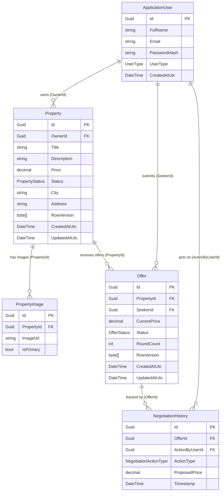

# Makanak MVP — Entity Relationship Diagram

> Generated strictly from MVP scope entities only.
> All FKs are `Guid`. Crow's foot notation via Mermaid `erDiagram`.

---

## Key Design Decisions

| Decision | Rationale |
|---|---|
| `Property.City` + `Property.Address` | Replaces `Point Location` (NetTopologySuite removed from MVP) |
| `PropertyImage.IsPrimary` | Enables single-query primary image loading via EF filtered `Include` |
| `NegotiationHistory` — `DeleteBehavior.Restrict` | Immutable audit log — rows must never cascade-delete |
| `RowVersion` on `Property` and `Offer` | Optimistic concurrency control (NFR-03) |
| `NegotiationHistory.ActionByUserId` FK → `ApplicationUser` | Supports both Owner and Seeker as actors |
| Max 2 `RoundCount` enforced in `Offer.Counter()` domain method | Business invariant lives in the Domain layer, not the DB |
